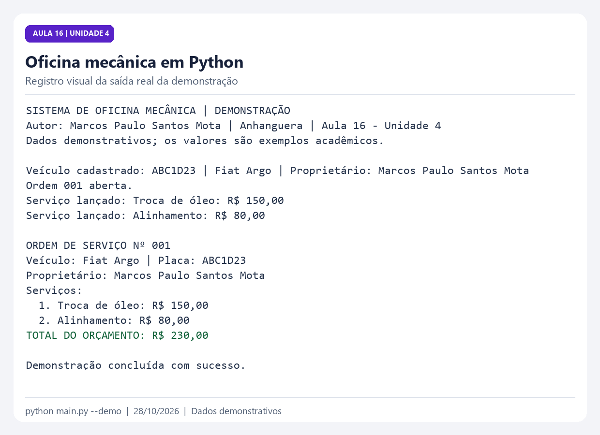

# Sistema de Oficina Mecânica

**Autor:** Marcos Paulo Santos Mota  
**Instituição:** Anhanguera  
**Atividade:** Aula 16 - Unidade 4 - Projeto Prático em Python  
**Foco da aula:** Arquivo 5, `README.md` - Documentação do projeto  
**Data:** 28 de outubro de 2026

**Repositório público:** [Acessar no GitHub](https://github.com/Mark1513/oficina-mecanica-python-anhanguera)

## Descrição

Projeto acadêmico desenvolvido em Python para cadastrar veículos, lançar serviços e gerenciar ordens de serviço em uma oficina mecânica. A aplicação funciona no terminal e organiza o orçamento de cada veículo.

Este README explica o objetivo, os arquivos e a utilização do sistema. Os quatro módulos principais seguem a organização apresentada no material da aula.

## Objetivo do sistema

Relacionar veículos aos serviços solicitados, calcular o total de cada orçamento e apresentar um resumo da ordem de serviço. O projeto também demonstra orientação a objetos, organização de código e documentação em Markdown.

## Funcionalidades

- Cadastrar veículos com placa, modelo e nome do proprietário.
- Listar os veículos cadastrados.
- Abrir ordens de serviço para veículos existentes.
- Registrar troca de óleo e alinhamento, informando o preço de cada serviço.
- Listar as ordens abertas e seus totais.
- Calcular o valor do orçamento.
- Exibir o resumo com veículo, proprietário, serviços e total.
- Tratar placas duplicadas, campos vazios, preços inválidos e opções incorretas.
- Executar uma demonstração pronta com `--demo`.

## Tecnologias utilizadas

- **Python 3.10 ou superior.**
- Biblioteca padrão: `dataclasses`, `abc`, `decimal`, `argparse` e `unittest`.
- **Markdown** para a documentação.
- **GitHub Actions** para repetir os testes no repositório.

Não há bibliotecas externas nem necessidade de executar `pip install`. O VS Code pode ser usado como editor, mas não é obrigatório.

## Estrutura de arquivos

```text
oficina_mecanica/
├── main.py                    # Menu, cadastros e demonstração
├── veiculo.py                 # Classe Veiculo e validação dos dados
├── servico.py                 # Servico, TrocaOleo, Alinhamento e valores em reais
├── ordem_servico.py           # OrdemServico, cálculo do total e resumo
├── README.md                  # Documentação solicitada na Aula 16
├── executar.cmd               # Atalho para o menu no Windows
├── demonstrar.cmd             # Atalho para o exemplo no Windows
├── testar.cmd                 # Atalho para os testes no Windows
├── tests/
│   └── test_oficina.py         # Testes das regras e do menu
├── docs/
│   ├── GUIA_DIDATICO.md        # Classes e roteiro de apresentação
│   ├── VALIDACAO.md            # Resultados efetivamente verificados
│   ├── execucao.png            # Registro visual da saída real
│   ├── execucao_real.txt       # Saída da demonstração
│   └── testes_reais.txt        # Saída dos testes
├── .github/workflows/
│   └── testes.yml             # Validação automática no GitHub
└── .gitignore                 # Exclui caches e ambientes locais
```

## Como executar o sistema

### 1. Preparar a pasta

Extraia o ZIP completo. Abra o terminal na pasta `oficina_mecanica`, onde está `main.py`.

### 2. Conferir o Python

```console
python --version
```

Utilize Python 3.10 ou superior. No Windows, se o comando disponível for `py`, substitua `python` por `py -3`. No Linux e macOS, pode ser necessário usar `python3`.

### 3. Abrir o menu

```console
python main.py
```

No Windows, também é possível dar dois cliques em `executar.cmd`. Esse atalho procura uma instalação compatível de `py` ou `python`; neste computador, também reconhece o Python disponibilizado pelo aplicativo Codex. A janela permanece aberta após o programa encerrar.

### 4. Executar o exemplo pronto

```console
python main.py --demo
```

O exemplo usa dados demonstrativos, cadastra um veículo, abre uma ordem e adiciona dois serviços. A execução não exige digitação. No Windows, use também `demonstrar.cmd`.

## Exemplo de uso pelo menu

1. Escolha **1 - Cadastrar veículo** e informe `ABC1D23`, `Fiat Argo` e `Marcos Paulo Santos Mota`.
2. Escolha **3 - Abrir ordem de serviço** e informe a placa `ABC1D23`.
3. Escolha **4 - Lançar serviço**, informe a ordem `1`, selecione `1 - Troca de óleo` e digite `150,00`.
4. Repita a opção **4**, informe a ordem `1`, selecione `2 - Alinhamento` e digite `80,00`.
5. Escolha **5** para listar as ordens, **6** para calcular o orçamento ou **7** para ver o resumo. Nas opções 6 e 7, informe a ordem `1`.
6. Escolha **0** para sair.

Resultado esperado do resumo:

```text
ORDEM DE SERVIÇO Nº 001
Veículo: Fiat Argo | Placa: ABC1D23
Proprietário: Marcos Paulo Santos Mota
Serviços:
  1. Troca de óleo: R$ 150,00
  2. Alinhamento: R$ 80,00
TOTAL DO ORÇAMENTO: R$ 230,00
```

Os preços são exemplos acadêmicos e não representam uma tabela comercial. O usuário informa os valores durante o lançamento. É permitido lançar vários serviços, inclusive do mesmo tipo, em uma ordem.

### Registro visual da demonstração



Imagem composta a partir da saída capturada do Python, sem alterar os resultados. O arquivo de texto original está em `docs/execucao_real.txt`.

## Regras e conceitos aplicados

| Requisito | Arquivo ou classe responsável |
| --- | --- |
| Cadastrar e validar veículos | `Veiculo`, em `veiculo.py`, e `Oficina`, em `main.py` |
| Registrar troca de óleo e alinhamento | `TrocaOleo` e `Alinhamento`, em `servico.py` |
| Abrir e consultar ordens | `Oficina`, em `main.py` |
| Relacionar veículo e serviços | `OrdemServico`, em `ordem_servico.py` |
| Calcular o orçamento | `OrdemServico.calcular_total()` |
| Exibir o resumo | `OrdemServico.resumo()` |
| Documentar e orientar a execução | Este `README.md` |

- **Classes e objetos:** cada veículo, serviço e ordem é representado por um objeto.
- **Encapsulamento:** a ordem controla a inclusão dos serviços e oferece uma tupla para consulta. Veículos e preços são imutáveis após a criação.
- **Abstração e herança:** `Servico` define um contrato comum; `TrocaOleo` e `Alinhamento` herdam sua validação e fornecem seus nomes.
- **Polimorfismo:** a ordem trabalha com serviços que seguem o contrato `Servico`.
- **Relacionamentos:** uma ordem referencia um veículo e reúne vários serviços.
- **Tratamento de erros:** operações inválidas exibem uma mensagem e devolvem o usuário ao menu.
- **Valores monetários:** `Decimal` evita os erros de representação binária típicos de `float`; o preço é arredondado para centavos com `ROUND_HALF_UP`.

As placas aceitas seguem os formatos `ABC-1234` e `ABC1D23`. A placa é armazenada sem hífen e em letras maiúsculas. Os preços devem ser positivos e podem usar vírgula ou ponto como separador decimal, sem separador de milhar.

Uma ordem pode ser aberta sem serviços; nesse caso, seu total é `R$ 0,00`. O número da ordem é sequencial durante a sessão. Veículos inexistentes não podem receber ordens.

## Como executar os testes

Na pasta do projeto:

```console
python -m unittest discover -s tests -v
```

No Windows, pode-se usar `testar.cmd`. São **28 testes** que verificam cadastros, duplicidade de placas, preços, soma de centavos, numeração das ordens, resumos e navegação pelo menu. Um deles inicia a demonstração em outro processo Python.

Os resultados reais desta entrega estão em [Validação](docs/VALIDACAO.md), com a [saída dos testes](docs/testes_reais.txt) e a [saída da demonstração](docs/execucao_real.txt).

## Limitações da versão

Os dados ficam somente na memória e são apagados ao fechar o programa. Não há banco de dados, interface web, autenticação, emissão fiscal ou processamento de pagamentos. O orçamento soma os preços informados, sem descontos ou impostos. Esses limites correspondem ao escopo desta versão acadêmica.

## Possíveis melhorias

- Salvar veículos e ordens em SQLite ou arquivos JSON.
- Incluir revisão, balanceamento e outros serviços.
- Acompanhar o status da ordem: aberta, em execução e concluída.
- Gerar orçamentos em PDF.
- Construir uma interface web reutilizando as classes, conforme a próxima etapa indicada na aula.

## Documentação e apresentação

O [guia didático](docs/GUIA_DIDATICO.md) explica as classes, traz respostas às perguntas de reflexão da aula e um roteiro para apresentar o trabalho. O README é escrito em Markdown: títulos, listas, tabelas e blocos de código facilitam a leitura no GitHub. No VS Code, abra o arquivo e utilize a visualização de Markdown para conferir a formatação.

## Autoria e uso

Trabalho acadêmico de **Marcos Paulo Santos Mota**, elaborado para a Anhanguera em 28 de outubro de 2026. Material destinado a estudo e avaliação acadêmica. Não foi concedida uma licença aberta específica a esta entrega.
